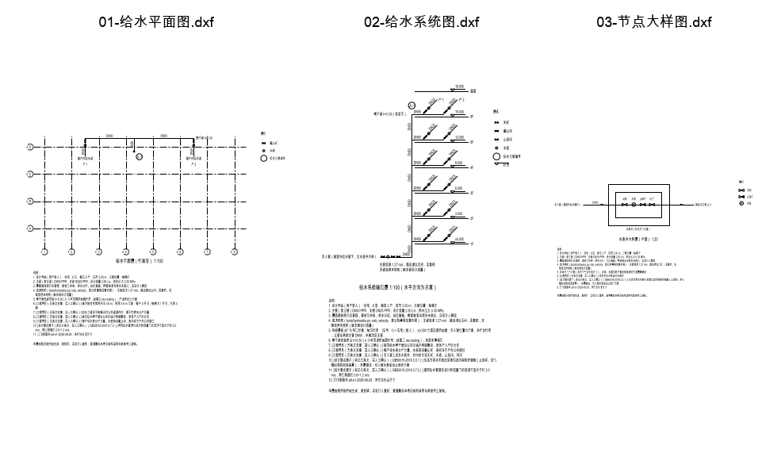
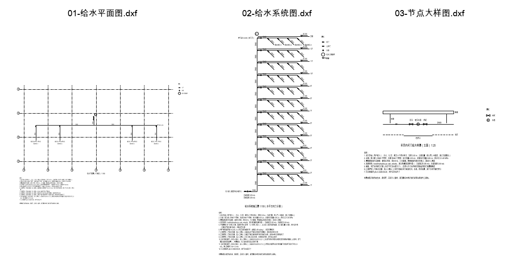
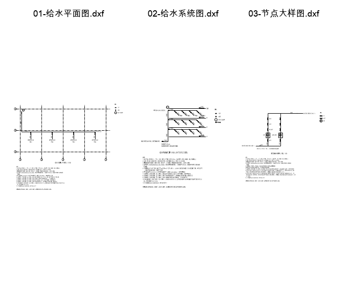

# P6-S1 决策记录：参数化生成给水系统 DXF 图纸

日期：2026-09-29 / 30　状态：已交付（Step 1–7；本机 + 隔离 compose 镜像实测）
规格：`docs/design/p6-step-1-parametric-drawing-generation.md`；执行 prompt：`docs/execution-prompts/P6-S1-parametric-drawing-generation.md`（其 §0 对 spec 的修订以 prompt 为准）

> 一句话：输入结构化给水参数，确定性程序生成**标准层平面图、给水系统轴测图、节点大样图**三张 DXF，
> 读回核对、S50 复审后打 ZIP 下载。**这是程序生成的初稿，需设计人复核**；只证明了 ezdxf 与
> LibreDWG 能正常读取，**没有**在 AutoCAD / 天正里打开验证过。

## 0. 偏离与修订

### 0.1 执行 prompt §0 的修订（照做）

| spec 原文 | 本步做法 |
|---|---|
| 生成后自动触发 `review_drawing`，报告"0 缺陷 / 3 警告" | 逐张用 S50 `review_uploaded_dxf()` 复审，报告**原样**附上（含未检查项），不写"审查通过" |
| `ezdxf.addons.drawing` 渲染 PDF 预览 | 不做（Pillow / matplotlib 不在依赖里） |
| 字体"仿宋_GB2312" | 文字样式 `WS-FS`：字体 `simfang.ttf` + SHX 大字体 `gbcbig.shx` + 扩展字体族 `仿宋`，宽度因子 0.7 |
| 只输出 DXF | DXF 为主；DWG 为**实验性**可选输出（LibreDWG `dxf2dwg`，`dwg2dxf` 回读核对，核对不过只交付 DXF） |
| 路由放 `run_routes.py` | 新建薄适配器 `webapp/drawing_routes.py` |
| 文件落任意位置 | `resolve_export_dir()/drawings/{generation_id}/` |

### 0.2 本步实测后追加的偏离（执行 prompt 的前提与代码现实不符）

1. **规则表 `basis` 用三档，不是两档**。prompt 写 `formal_clause` / `engineering_practice` 两档，前提是"GB50015-2019 只有 4.7.1 自述非正式"。实测 `GB50015-2019` 在库 **9 条全部**自述"联网整理的设计要点综述，非正式规范条文"（`tests/test_drawing_building_rules.py::test_gb50015_in_corpus_is_entirely_informal` 锁死）。两档制下，3.7.3（流速）、3.3.1（防倒流）这类能指回真实 source_id 的要点综述只能降为工程惯例，溯源就丢了；而标 formal 又是伪造依据。故沿用 P3 `drawing/rules.py` 的 `EvidenceLevel` 三档，中间档 `informal_summary` 必须带 source_id，图面写"设计要点提示（非正式条文，需人工确认）"。
2. **S50 复审对纯给水图会说"已检查的规则均未发现问题，未检查 0 项"**。prompt 以为"给水图多数规则会落到未检查"，实测不是：三条排水规则在图上没有排水管段时直接 `return [], []`，给水管段根本没有规则去查，`summary()` 却落到"已检查的规则均未发现问题"。原样附上这份报告就等于写了"审查通过"。修法放在唯一出口 `rules.py`（单独 commit `fix(drawing)`）：`check_rule_scope` 把给水管段计入 `not_checked`，`ReviewResult.water_supply_pipes` 等于全部管段时结论改为"**未对任何管段执行规则判定**……不含任何合规判断"（与零管段同一纪律）。**这也改变了 S50 上传真实给水图的报告**——那本来就是同一个缺陷；`drawing_p0` 的 dw-005 gold 随之更新。
3. **复审的"已审查管段"比生成器画的管段多**。`map_pipes` 把**所有** LINE / LWPOLYLINE 都当管段（P3 Step 21 残余风险 2），轴网线、阀门符号里的线条、大样轮廓都被计入。本步不改审查器，结果里两个数分开报：生成器自己的管段数（`WS-PIPE-*` 图层，`pipe_segments`）与审查器口径的 `pipes_reviewed`。
4. **请求契约多三个可选字段**：`riser_position` 缺省时取规则表默认（spec D2"用户指定或规则默认"）；`branch_flow_rate_lps` 支管设计流量，缺省时支管流速**不校核**并进 `missing_inputs`（不按总流量均分估算）；`include_dwg` 默认 `false`，DWG 是实验性输出，需用户显式勾选。
5. **多一个图层 `WS-OUTLINE`**（大样里的井壁、楼板、吊顶、吊架、水泵基础）。prompt 列的七个图层里没有能放构筑物轮廓的。
6. **管径标注只写 `DN50`，不写材质**；材质写进说明。标注要压在管线 20 图纸单位以内（`ANNOTATION_MATCH_RADIUS`），基线距管线 12 mm，1:100 出图时约 0.12 mm，图面上标注紧贴管线。代价是复审会报"material：N 条管段无材质标注"；且审查器的 `_MATERIAL_HINTS` 不认识"钢塑复合"，即使写上也读不出（审查器词表缺口，不在本步修）。
7. **图名字高 5 mm**，其余文字 3.5 mm × 出图比例。
8. **`DrawingReviewText` 追加 `summary` / `not_checked_items`**（默认空，向后兼容），出图复审原样转交前端，不从报告文本里再解析一遍。

## 1. 交付

| Step | 产物 | 要点 |
|---|---|---|
| 1 | `drawing/building_type_rules.json`、`drawing/building_rules.py` | 三类建筑的柱网、立管位置、敷设方式、阀门水表、引入管、大样类型；pydantic `extra="forbid"`；图面说明唯一出口 `RuleText.rendered_note()` |
| 2 | `drawing/generation_models.py`（契约部分）、`tests/eval/drawing_gen_p0/` | `GenerationRequest`（frozen，DN15–DN150 白名单、4 种材质、层数 1–33、每层 1–8、压力 0.1–1.0、层高 2.4–6.0）；三个稳定错误码；主/支管分别调 `calc_velocity`；**评测集先于生成器入库** |
| 3 | `layout_engine.py`、`system_schematic.py`、`detail_drawings.py`、`generation_models.py`（规划数据模型 + `validate_sheet`） | 纯数据、不碰 ezdxf；坐标 0.001 mm 取整，同请求逐字节相同 |
| 4 | `blocks.py`、`generator.py`、`documents/dwg_convert.convert_dxf_to_dwg` | 只做翻译；`verify_readback` 用本仓库 `read_drawing` + `map_pipes` 按 handle 核对每条管段管径；实验性 DWG |
| 5 | `generation_service.py`、`rules.py` 修正 | 校验 → 规划 → 渲染 → 读回（不过即 500）→ S50 复审 → DWG（可选）→ 原子落盘 → ZIP + README |
| 6 | `webapp/drawing_routes.py`、前端 `DrawingPanel.tsx` / `drawingApi.ts` / `drawingState.ts` | 三条路由；侧栏"生成图纸"面板 |
| 7 | `harness/drawing_gen_eval.py`、`scripts/compare_drawing_gen_p0.py`、`data/eval/drawing_gen_p0_main.json`、`ci_gate.sh`、`smoke.py`、Dockerfile | 门禁 + 冒烟 + 镜像带 `dxf2dwg` |

### 1.1 几何做法（都是示意，不是建筑条件图）

- **平面图 1:100**：轴网（CENTER 线型，轴号不用 I/O/Z）+ 立管断面圆与编号圈 `JL-1` + 立管到楼层横干管的连接管（楼层阀门 / 楼层水表装在这段上）+ 横干管（向两侧或单侧）+ 各单元支管（阀门、水表），支管末端注"接户内给水管"等。住宅横干管沿公共区墙边（轴线外偏 1.2 m），办公在走廊中线（吊顶内），商业沿柱网（轴线内偏 0.5 m），立管位置按 `riser.positions`。不画墙体、不标长度尺寸。
- **系统轴测图 1:100**：45° 斜等测，竖向按真实层高（楼层标高 = (层号 - 1) × 层高），水平方向示意。立管**逐层分段**（段数 = 层数，每段各有管径标注），每层一组支管；地面安装（住宅）斜支管向右上，吊顶安装（办公、商业）向右下，保证不越过楼层线。引入管附件取 `entry.components`。
- **节点大样 1:20**：住宅水表井（平面）、办公吊顶内阀门组（立面，下方留检修口）、商业泵房接管（1 用 1 备，进水检修阀、出水缓闭止回阀 + 工作阀 + 检修阀）。附件种类与顺序只取 `detail.components`。
- **不变量**（`validate_sheet`，服务交付前也跑一遍）：管段每个顶点都是已登记节点；每条管段恰一条管径标注、距管线 ≤16 mm，且是 20 mm 半径内离它最近的带管径文字——距离与 `parse_dn` 直接复用 `drawing/mapping.py`；附件落在所属管段上。属性测试扫 40 组参数（含 33 层 × 8 户、层高 2.4 / 6.0、DN15–DN150），另查标注不压别的管线与楼层线、附件不重叠、斜支管不越层。

### 1.2 UI 入口：侧栏

生成不绑定会话（路由不带 `thread_id`），和"长期记忆""设置"一样是全局工具页；放侧栏复用已有的"主区互斥面板"模式，三者任开其一都会关掉另外两个（有前端测试）。放会话工具栏会让人误以为生成结果属于某个会话。

### 1.3 同步生成

最大一套（33 层 × 8 户 + DWG）本机约 0.7 s，隔离 compose 镜像内冷启动 1.8 s，低于 prompt 规定的 5 s 改后台任务线；路由用 `run_in_threadpool` 跑，单进程最多两路并发（`asyncio.Semaphore(2)`），多余请求排队而不是失败。

## 2. 规则来源分级（`src/water_agent/drawing/building_type_rules.json`）

分级标准与 P3 Step 21 D2 相同：**能否指回一个真实可检索的 source_id，且原文不自述非正式**，不是"文本看起来在库里"。

| rule_id | 内容 | basis | source_id |
|---|---|---|---|
| `ws.pipe_velocity` | 流速不宜大于约 2.0 m/s，常规 0.6~1.2 m/s；超出只提示复核 | informal_summary | GB50015-2019 3.7.3 |
| `ws.backflow_prevention` | 倒流污染防护设止回阀等；本图引入管水表后设止回阀 | informal_summary | GB50015-2019 3.3.1 |
| `ws.pump_suction_valve` | 最高进水液位高于水泵进水管时设手动检修阀 | formal_clause | GB50013-2018 6.3.3 |
| `ws.pump_discharge_valves` | 出水管设工作阀和检修阀，不用无缓闭功能的普通逆止阀 | formal_clause | GB50013-2018 6.3.5 |
| `res.*` / `off.*` / `com.*` | 柱网、立管位置、敷设方式、阀门水表设置、引入管、大样类型 | engineering_practice | — |

- 两条 formal 都来自《室外给水设计标准》的泵房条文。用于建筑内加压泵房是否合适需要设计人判断，规则表用 `scope_note` 把这句提醒一起渲染到图面。
- 每条可指回语料的规则都带 `corpus_quote`（原文逐字片段），测试逐条核对它在该 source_id 的语料里真实存在；formal 的原文不得含"非正式"，informal 的原文必须含。
- 图面说明的唯一出口是 `RuleText.rendered_note()`：工程惯例一档不得出现任何规范号，非正式档不得出现 `FORBIDDEN_IN_INFORMAL` 里的合规措辞（与 P3 共用常量）。
- 图上的数值只有三类来源：输入参数（管径、层数、层高、流量、压力）、`calc_velocity` 的结果（流速）、规则表（横干管安装高度 `h+0.30` 等，带 rule_id 与等级）。流速建议区间取 3.7.3 的"常规取值 0.6~1.2 m/s"，上限取"不宜大于约 2.0 m/s"；`calc_velocity` 自己的越界标注（口径表 §1 的 0.6–1.5 m/s）原样留在计算记录里，两者依据不同、分别标注。

## 3. 不做

- 排水、消防、热水；建筑结构（梁板柱、墙体）；三维 / BIM。
- 长度尺寸标注；图签、会签栏、图框、图纸目录。
- 读取用户上传的底图来布管。
- 模型可调用工具（工具 schema headroom 只剩 130 token；本步只有 HTTP 路由）。
- PDF 预览。
- 供水分区与减压阀（`pressure_mpa` 只作为设计参数写进说明）；横管坡度数值；立管逐层变径（缺逐层设计秒流量，不猜）；DN 与 De 的换算（换算表不在输入与计算结果里）；按管材壁厚换算内径（流速按公称直径估算，结果里写明）。

## 4. 实测

本机 macOS（Apple Silicon）；容器为本仓库镜像（只读根文件系统，uid 10001）。

**验收三套**（各勾选实验性 DWG）：

| 建筑 | 参数 | 生成耗时 | 图 | 读回图元 | 生成器管段 | 读回管径一致 | 复审"已审查管段" | 复审未检查 |
|---|---|---|---|---|---|---|---|---|
| 住宅 | 6 层 × 2 户，楼梯间，DN50 / DN25 PPR，2.5 L/s | 0.42 s | 平面 / 系统 / 大样 | 85 / 222 / 40 | 5 / 25 / 1 | 5 / 25 / 1 | 20 / 66 / 8 | 1 / 1 / 1 |
| 办公 | 12 层 × 4 单元，核心筒，DN80 / DN40 不锈钢，4.0 L/s | 0.22 s | 平面 / 系统 / 大样 | 87 / 421 / 35 | 7 / 73 / 1 | 7 / 73 / 1 | 24 / 178 / 10 | 1 / 1 / 1 |
| 商业 | 3 层 × 4 商铺，边角，DN65 / DN25 PPR，3.0 L/s | 0.19 s | 平面 / 系统 / 大样 | 85 / 159 / 62 | 6 / 19 / 4 | 6 / 19 / 4 | 20 / 50 / 16 | 1 / 1 / 1 |

- 上限：33 层 × 8 户 + DWG，本机 0.7 s，容器内冷启动 1.8 s；系统图读回 2,766 个图元（含块展开，低于 S50 的 20,000 上限）、331 条管段全部管径一致。
- `drawing_gen_p0` 14/14：`dn_match_rate` / `readback_rate` / `review_honesty_rate` 均为 1.0，最慢一条 336 ms。
- `ci_gate.sh`：全部步骤通过（pytest 2880 条收集、ruff、mypy，以及新增的 `drawing_gen_p0` 与更新 gold 后的 `drawing_p0` 8/8 在内的全部 harness 与基线对比）。本机跑门禁时用 `COMPOSE_PROJECT_NAME` 与本机另一 checkout 正在运行的 `water-agent` compose 栈隔离——否则 memory_p0 的备份用例会去备份那个栈，且因 worktree 没有 secrets 而误报 `MEMORY_FORGET_RESIDUAL`（main 上的既有缺陷，修复在未合并分支 4e8be40；未改门禁基础上的 main 同样会这样失败）。
- 前端：`npm test` 57/57、`typecheck`、`build` 通过；本地预览（SQLite 临时库）实测登录 → 生成 → 切换建筑类型立管随规则默认变化 → 勾选 DWG → 下载 ZIP。
- 容器：隔离 compose 项目、独立镜像 tag（`water-agent-*:p6s1`，不覆盖本机其他栈在用的 `:local`）、不占宿主端口；`docker compose run --rm smoke` → `ok=true passed=31 failed=0`，新增 `drawing_generate_and_download` 通过（ZIP 25,651 B，三张 AC1024 DXF 均被 `ezdxf.readfile` 打开，每张复审未检查 1 项）；`check_image.sh` PASS（漏洞扫描器因 docker-scout 未登录 SKIP，既有情况）。

**截图**（ezdxf 的 matplotlib 后端在一次性环境里渲染，Pillow / matplotlib 不进项目依赖；不是 CAD 软件截图）：

- 住宅：
- 办公：
- 商业：

## 5. 复审结果原样摘录（住宅 · 01-给水平面图.dxf）

```text
【DXF 程序化审查报告】已审查管段 20 条，待核问题 0 条，未检查 1 项。以下由规则引擎确定性生成（不调模型），是审查结论而非图纸原文；转述时必须保留"未检查项"，不得把未检查写成合规。

== 图纸审查报告：01-给水平面图.dxf ==
审查对象抽取：成功
已审查管段：20
结论：**未对任何管段执行规则判定**：20 条管段均识别为给水，现有规则只适用于排水管段，本结论不含任何合规判断
【未检查项（1 项）】
- 给水管段：现有 4 条规则全部只适用于排水管段（drain.*），20 条给水管段不在任何规则的作用域内，**未检查**（不代表给水管段合规）
【缺输入（2 项）】
- dn_mm：15 条管段无管径标注（WS-VALVE#6A:virtual-0、WS-VALVE#6E:virtual-0、WS-VALVE#74:virtual-0…）。管径只取自标注的显式 DN/De 声明，不从线宽或图层推断
- material：20 条管段无材质标注（WS-PIPE-MAIN#60、WS-PIPE-MAIN#61、WS-PIPE-MAIN#62…）。不假定默认管材（管材差价大，猜错直接影响造价）
【假设（1 项）】
- 管段属性按标注与管线的图面邻近关系匹配（半径 20.0 图纸单位）；这是工程惯例而非规范规定，标注位置异常的图纸需人工复核对应关系
```

读法：20 条"管段"= 生成器画的 5 条 + 12 条轴线 + 3 个阀门符号的外框线；无管径的 15 条正是轴线与符号线（生成器画的 5 条全部读出了管径）；无材质是因为图面只注管径（§0.2 第 6 条）。

## 6. DWG 输出与回读核对

- **启用方式**：请求里 `include_dwg=true` 才做（前端复选框，默认不勾），转换器缺失时复选框置灰。镜像从已构建的 LibreDWG 阶段多拷一个 `dxf2dwg`（该阶段缓存不失效）；`dxf2dwg_path()` 先看 `WATER_AGENT_DXF2DWG`，再找 `dwg2dxf` 同目录，再找 PATH。
- **子进程约束**与 S51 的 `dwg2dxf` 一致：固定 argv、`shell=False`、临时目录固定文件名 `in.dxf` / `out.dwg`、超时 60 s、`RLIMIT_AS/CPU/FSIZE`、环境变量白名单（有密钥不进子进程的断言）；子进程调用点仍只在已登记的 `documents/dwg_convert.py`。
- **回读核对**：DWG → `dwg2dxf`（含 S51 的 handle 0 修补）→ `read_drawing`，核对 `WS-PIPE-*` 管段数、管径多重集、全部单行文字与说明逐行一致；任何一项不一致就丢弃 DWG，结果与 README 写明原因，只交付 DXF；DWG 输出的任何内部异常也只降级为"失败"，不连累 DXF。
- **实测两处 LibreDWG 坑（都由回读核对当场拦下）**：
  1. `dxf2dwg` 把 R2010 DXF 里的 UTF-8 字节**原样**写进 R2000 DWG，不做代码页转换，回读后中文全部乱码（设 `$DWGCODEPAGE=ANSI_936` 也一样）。改为另渲染一份 **R2000 + GBK** 编码的 DXF 作 DWG 源文件。
  2. ezdxf 把 R2000 的 MTEXT 正文按 250 个**字符**分段写出，GBK 下每段超过 255 字节，LibreDWG 把段尾截坏。DWG 源文件的说明改为逐行单行文字；说明本身统一按 60 字宽折行。
- **结果**：验收三套共 9 个 DWG 全部 `status=ok`（R2000 / AC1015）；LibreDWG `dwgread -O JSON` 独立打开 9/9 返回 0，八个 `WS-*` 图层齐全，中文文字（"闸阀""水表""楼层水表"）可读；每个文件转换器输出约 83 条 ERROR/Warning 行（MATERIAL、MLEADERSTYLE 等对象不支持），不影响几何与文字。容器内（Linux，rlimit 生效）同样 `ok`。
- **没有**在 AutoCAD / 天正中打开验证；LibreDWG 写 DWG 仍是实验功能，图面标注"实验性"。

## 7. 残余风险

1. **布置规则只有三种**（沿墙 / 走廊吊顶 / 柱网），户型、核心筒、商铺都按规则化的轴网示意，不读建筑条件图；**未考虑结构梁高与其他专业管线**（每张图左下角固定声明）。
2. **给水审查规则覆盖为零**：现有 4 条规则全部针对排水，复审对给水图只能如实报"未检查"，**不提供任何合规证据**。
3. **审查器口径**：把轴网、符号、轮廓线都算作管段（`pipes_reviewed` 偏大）；不识别"钢塑复合"；图面只注管径，复审报材质缺失。这些是审查器的已知缺口，本步只如实呈现，未修。
4. **没有真实 CAD 打开验证**：只证明 ezdxf / LibreDWG 可正常读取。`simfang.ttf` / `gbcbig.shx` 在 CAD 里的实际显示、标注紧贴管线（基线距管线 0.12 mm）在出图后的观感，都未实测。
5. **DWG 是实验性输出**：R2000，转换器大量告警，AutoCAD 兼容性未知。
6. **流速按公称直径估算内径**；缺支管流量时支管流速不校核；立管不做逐层变径。
7. **符号未逐一核对 GB/T 50106 原图**（该标准不在语料库），每张图附图例。
8. **导出卷无 retention**：生成的图纸长期留在 `app_exports` 卷上，长期运行会无界增长（与上传卷同一残余）。
9. `rules.py` 的修正改变了 S50 上传真实给水图的报告（从"未检查 0 项"变为如实报给水管段未检查）——这是本意，但读报告的人会看到口径变化。
10. 只读根文件系统下 ezdxf 每个进程会打印一次"Cannot create cache home directory"（字体缓存写不进 `$HOME`），无害，未处理。
